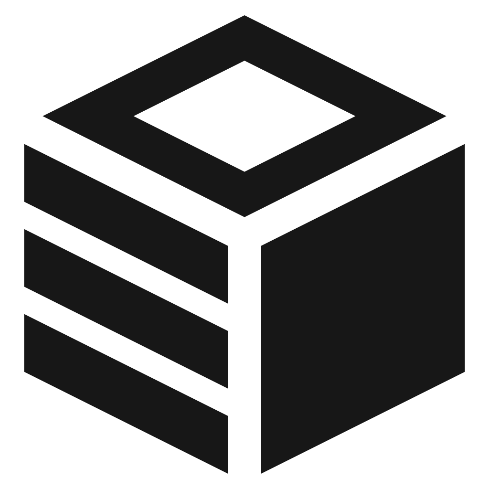
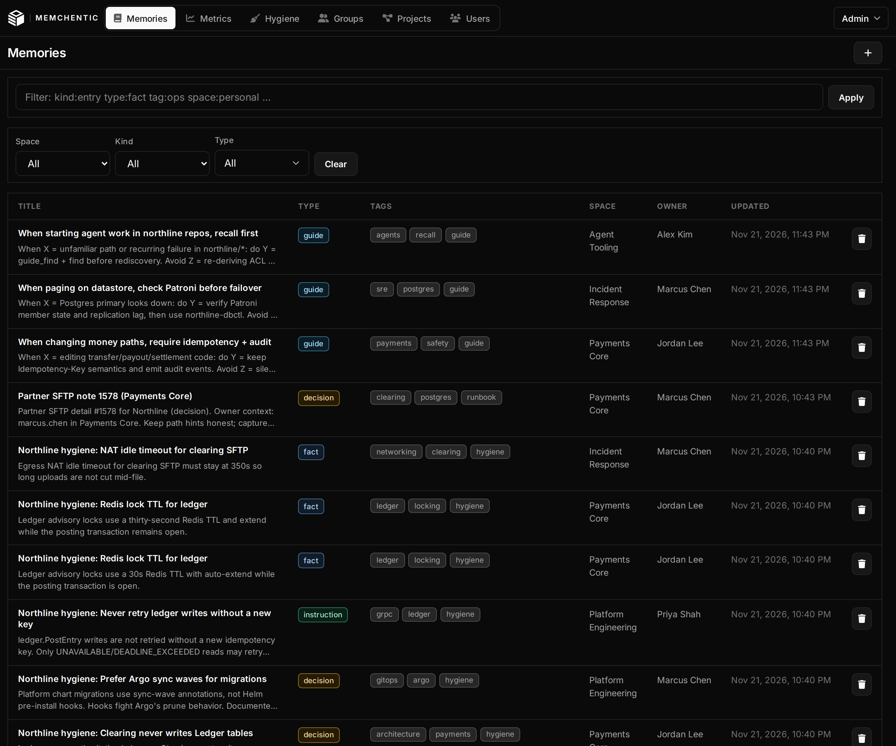
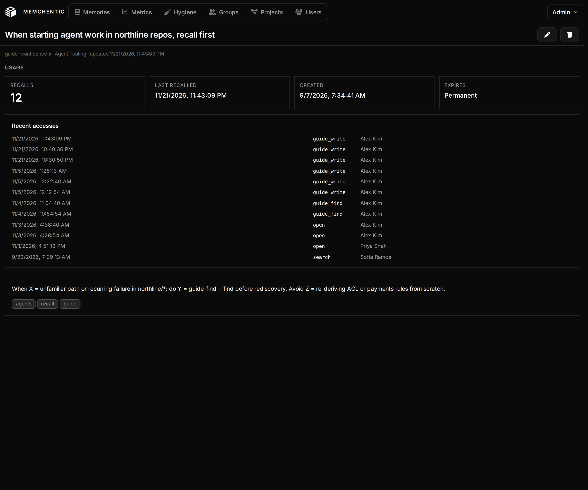
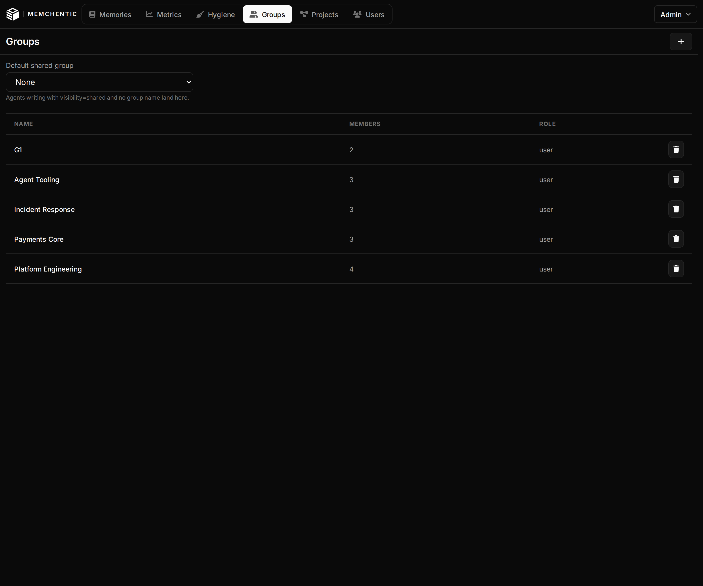
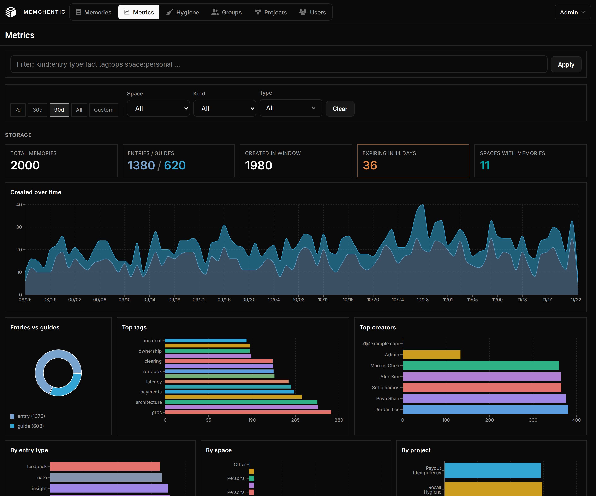

  <picture>
    <source media="(prefers-color-scheme: dark)" srcset="docs/assets/mark-white.svg">
    
  </picture>

<h1 align="center">memchentic</h1>

  <strong>Memory that sticks with your agents</strong> 
  Across sessions, tools, and people — so agents stop rediscovering what you already taught them.

  <a href="https://memchentic.ai/">Website</a>
  ·
  <a href="https://docs.memchentic.ai/">Docs</a>
  ·
  <a href="https://docs.memchentic.ai/docker.html">Deploy</a>
  ·
  <a href="https://docs.memchentic.ai/connect-mcp.html">Connect MCP</a>

  

## Brilliant in the moment. Amnesiac the next.

Agents lose the preferences you already explained, the decisions your team already made, and the hard-won lessons from last week’s incident or review — in support, ops, research, or code.

Shared work makes it worse. One person’s runbook or policy never reaches the next person’s session — until something recalls it.

**memchentic** is a self-hosted memory service built for agentic work. You run it. Your agents connect to it. They remember what matters, find it again later, and respect who is allowed to see what.

## Built for how agents actually work

| | |
| --- | --- |
| **You run it** | Compose or Helm where you already operate. Your data stays yours. |
| **Agents connect** | MCP-native — the same application is the memory server. No glue service. |
| **ACL holds** | Personal stays personal; groups stay intentional. Real users, server-enforced access. |

Agents write durable memory when something is verified and worth keeping. They read it back at the start of the next job — across Cursor, Claude Code, Copilot, Codex, and other MCP clients.

  

## Shaped the way people think — not one blob of text

Memories are **entries** (facts, preferences, decisions, insights) and **guides** (lessons worth re-teaching). Agents get a short digest first, then open the full memory when they need it — so context stays useful instead of drowning the chat.

Search mixes keyword and meaning so “that Postgres pool bug” still surfaces when the wording changes. Optional groups share what belongs to the product, not just one laptop. A web console lets humans browse, search, and manage keys when they want to see what agents stored.

  

## See the shape of what your agents remember

The console ships Metrics — totals, created-over-time, types, spaces, tags, and creators — scoped by the same ACL as every memory read. Operators get a pulse without paging the whole corpus.

  

## Why people adopt it

- **Continuity** — across sessions and tools, without pasting the same brief every time
- **Hybrid retrieval** — structured filters, full-text, and vectors fused for recall that stays fast and current
- **Auth that fits the harness** — org login or built-in accounts; agents act as real users
- **Operator-owned** — run it where you already run containers
- **Agent-native** — MCP-first, with a polished console when humans need to look
- **History, hygiene, and hooks** — revisions, consolidation, feedback signals, and webhooks for the rest of your stack

## Get started

Setup, deploy, MCP connection, and the marketplace plugin live in the docs — not here.

| Start with | Link |
| --- | --- |
| Overview & concepts | [docs.memchentic.ai](https://docs.memchentic.ai/) |
| Docker Compose | [Docker](https://docs.memchentic.ai/docker.html) |
| Kubernetes | [Helm](https://docs.memchentic.ai/helm.html) |
| Point an MCP client | [Connect MCP](https://docs.memchentic.ai/connect-mcp.html) |
| Marketplace plugin | [Install marketplace](https://docs.memchentic.ai/install-marketplace.html) |
| Tools reference | [MCP tools](https://docs.memchentic.ai/mcp-tools.html) |

Product site: [memchentic.ai](https://memchentic.ai/)

## License

[MIT](LICENSE)
