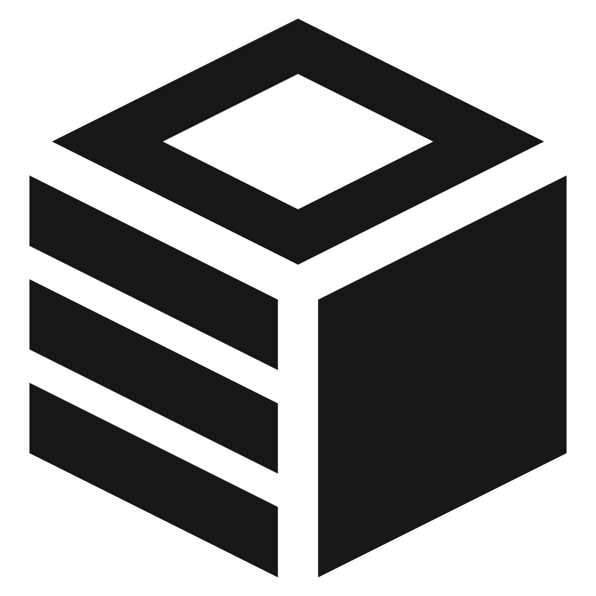

<p align="center">
  <picture>
    <source media="(prefers-color-scheme: dark)" srcset="docs/assets/mark-white.svg">
    
  </picture>
</p>

<h1 align="center">memchentic</h1>

<p align="center">
  Memory that sticks with your agents — across sessions, tools, and people.
</p>

## Built so agents remember what you already learned

Coding agents are brilliant in the moment and amnesiac the next. Every new
chat relearns your stack, your preferences, the bug you already fixed, and the
decision you already made. Context windows fill with rediscovery. Humans paste
the same “remember this” notes into prompts. Groups lose what one person taught
an agent last week.

**memchentic** is where those lessons live. Agents write durable memory when
something is verified and worth keeping. They read it back at the start of the
next job. You keep ownership of the data — self-hosted, multi-user, yours.

## Continuity without rediscovery

Personal space holds preferences, architecture calls, failed approaches, and
file-scoped notes across Cursor, Claude, and other MCP clients. Recall before
you re-investigate. Capture after you prove something, not before.

Optional groups share what belongs to the product, not just one laptop. A small
web console lets humans browse, search, and manage keys when they want to see
what agents stored. Identity stays yours: sign in via your IdP or built-in
accounts; agents use per-user API keys. Isolation is enforced on the server.

## Entries, guides, and hybrid recall

memchentic is an MCP memory server plus a React console. Agents talk to it over
streamable HTTP (`/mcp`). Memories are **entries** (facts worth keeping) and
**guides** (lessons worth re-teaching). Search mixes keyword and vector recall
so “that Postgres pool bug” still surfaces when the wording changes.

The server alone is a toolbox. The **accompanying marketplace plugin** makes the
loop autonomous: always-on recall and capture so the agent checks memchentic
early, saves verified insights without being asked, and skips the whole thing
when the MCP is disconnected.

## Start here

```bash
git clone https://github.com/memchentic/memchentic.git
cd memchentic/docker
cp .env.example .env
cp local.yaml.example local.yaml
# set admin password + API key; set BASE_URL and CORS_ORIGINS to your host
docker compose up -d --build
```

Open the UI on port `18080` (default), sign in, and create an API key. Point
your MCP client at `http://<host>:18080/mcp`.

Import this GitHub repo as a marketplace and install **memchentic**, then keep
the MCP connected so recall and capture run on their own. Plugin details live
under `marketplace/`; user docs under `docs/sphinx/`.

## License

MIT
