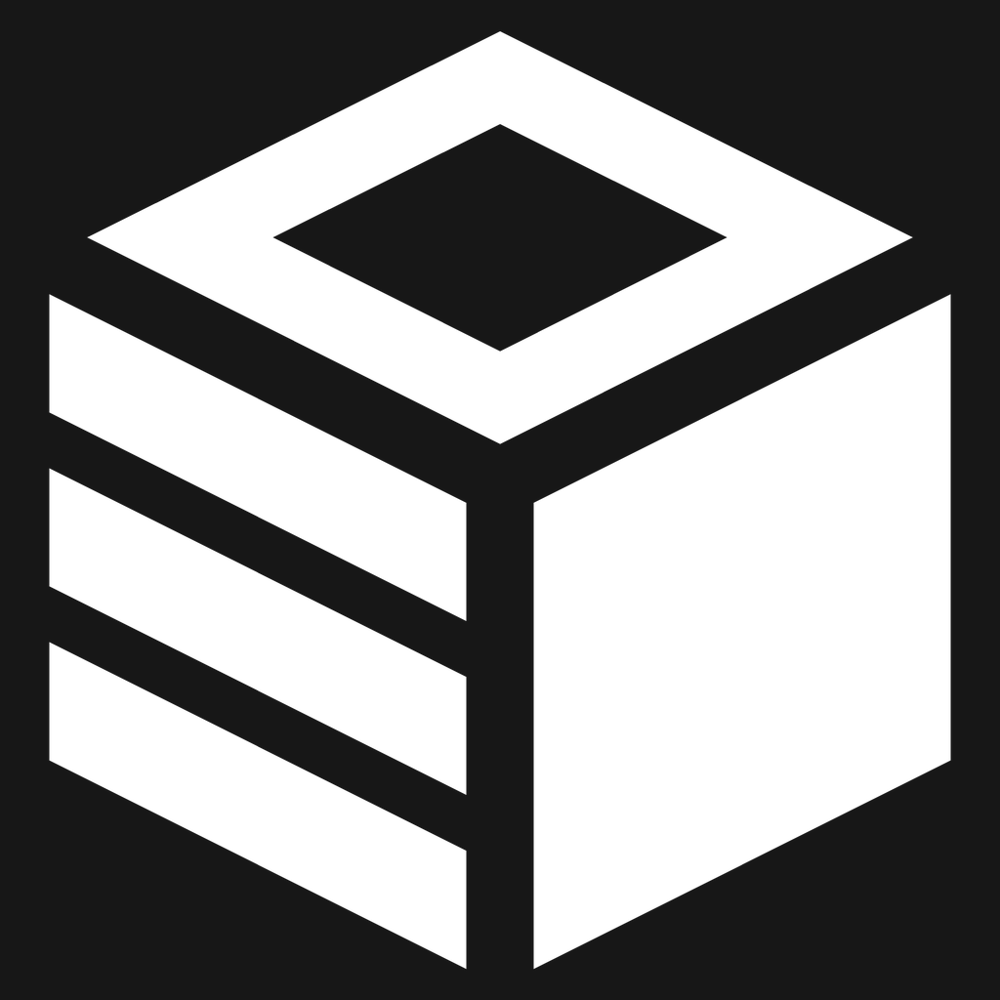

<p align="center">
  
</p>

<h1 align="center">memchentic</h1>

<p align="center">
  Memory that sticks with your agents — across sessions, tools, and people.
</p>

## Why this exists

Coding agents are brilliant in the moment and amnesiac the next. Every new
chat relearns your stack, your preferences, the bug you already fixed, and the
decision you already made. Context windows fill with rediscovery. Humans paste
the same “remember this” notes into prompts. Groups lose what one person taught
an agent last week.

**memchentic** is the place those lessons live. Agents write durable memory when
something is verified and worth keeping. They read it back at the start of the
next job. You keep ownership of the data — self-hosted, multi-user, yours.

## What it does for your workflow

- **Personal continuity** — preferences, architecture calls, failed approaches,
  and file-scoped notes survive across Cursor, Claude, and other MCP clients.
- **Less rediscovery** — recall before you re-investigate; capture after you
  prove something, not before.
- **Shared group memory** — optional groups so a roster can share what belongs to
  the product, not just one laptop.
- **Human oversight** — a web UI to browse, search, and manage keys when you
  want to see what agents stored.
- **Identity you control** — sign-in via your IdP or built-in accounts; agents
  use per-user API keys. Isolation is enforced on the server.

## How it works (briefly)

memchentic is an MCP memory server plus a small React console. Agents talk to
it over streamable HTTP (`/mcp`). Memories are **entries** (facts worth
keeping) and **guides** (lessons worth re-teaching). Search mixes keyword and
vector recall so “that Postgres pool bug” still surfaces when the wording
changes. Personal space is the default; groups are opt-in shared collections.

The server alone is a toolbox. The **accompanying marketplace plugin** is what
makes the loop autonomous: always-on recall and capture craft so the agent
checks memchentic early, saves verified insights without being asked, and
skips the whole thing when the MCP is disconnected. Install the plugin from
this repo, connect the MCP, and the posture rides along in Cursor, Claude Code,
Copilot, and Codex.

## Requirements

- Docker Engine with Compose v2
- A host the browser and MCP clients can reach (set URLs in `.env`)
- Embeddings: MiniLM ONNX is baked into the application image; override with
  `EMBEDDING_MODEL_PATH`. For the local compose overlay (host `models/` mount),
  run `scripts/fetch_minilm_onnx.sh` once so the bind mount is not empty.

## Getting started

```bash
git clone https://github.com/nodadyoushutup/memchentic.git
cd memchentic/docker
cp .env.example .env
cp local.yaml.example local.yaml
# set admin password + API key; set BASE_URL and CORS_ORIGINS to your host
docker compose up -d --build
```

Open the UI on port `18080` (default), sign in, and create an API key. Point
your MCP client at `http://<host>:18080/mcp`.

**Plugin:** import this GitHub repo as a marketplace and install **memchentic**,
then keep the MCP connected so recall/capture runs on its own. Details live
under `marketplace/`.

Official docs will cover auth providers, tenancy, and ops in depth. This README
is the front door.

## License

MIT
