# Memchentic

```{raw} html
<div class="memchentic-brand">
  
  <span class="memchentic-word">memchentic</span>
</div>
```

## The problem

AI coding assistants are powerful in the moment and forgetful the next. They
lose the preferences you already explained, the decisions your team already
made, and the hard-won lessons from last week's bug hunt. You end up repeating
yourself, pasting the same context into every chat, and watching the agent
reinvent choices you thought were settled.

Shared work makes it worse. One person's "how we do auth here" never reaches
the next person's session. There is no durable place for *your* memory and
*your team's* memory that agents can actually use.

## How Memchentic solves it

Memchentic is a self-hosted memory service built for agentic work. You run it.
Your agents connect to it. They remember what matters, find it again later, and
respect who is allowed to see what.

Personal memory stays private to you. Optional groups let a team share a
collection without turning every note into a free-for-all. A web UI is there
when you want to browse and manage memories yourself; day to day, the agents
do the remembering.

## Memory that fits how people think

Not everything is the same kind of knowledge. Memchentic stores different
shapes on purpose:

- **Facts** and **decisions** — what is true, and what you already chose
- **Preferences** and **instructions** — how you want the agent to work
- **Insights**, **feedback**, and **notes** — lessons and catch-alls
- **Guides** — reusable advice the agent should keep getting better at
  following, not a one-off scrap of text

Search is hybrid: plain language and meaning, not keyword bingo alone. Agents
get a short digest first, then open the full memory when they need it — so
context stays useful instead of drowning the chat.

## An MCP server, not a side script

Memchentic *is* the MCP server. The same application that serves the UI also
exposes the tool surface your harness already knows how to call. Point Cursor,
Claude Code, Copilot, Codex, or another MCP client at it; authenticate; and
the agent can save and recall without a separate glue layer.

You are not bolting memory onto the model with prompts alone. You are giving
the agent a real place to put knowledge, with isolation and a clear contract.

## Tools at a glance

The tool set is deliberately small and obvious:

- **Who am I / which spaces** — identity and the places memory can live
- **Remember and revise** — write durable entries; update or forget them
- **Find, browse, and open** — search or list, then load the full text
- **Guides** — capture and retrieve standing advice with confidence over time
- **Path-aware recall** — “what do we know about this part of the codebase?”
- **Housekeeping** — spot overlaps and stale items without silent auto-delete

Enough for a reliable agent loop. Not a zoo of megatools.

## Why people adopt it

- **Continuity** across sessions and tools, without pasting the same brief
  every time
- **Multi-user by design** — personal isolation, optional shared groups
- **Operator-owned** — run it where you already run containers; your data stays
  yours
- **Agent-native** — MCP-first, with a polished UI when humans need it
- **Original surface** — its own verbs and model, not a thin wrap of someone
  else's memory product

Ready to try it? Start with {doc}`getting-started` — Compose or Helm for the
server, then the marketplace plugin for your harness. Deeper pages cover
{doc}`memory-types`, {doc}`mcp-tools`, deploy options, and the
{doc}`marketplace` plugin.

```{toctree}
:caption: Product
:maxdepth: 1
:hidden:
:titlesonly:

getting-started
```

```{toctree}
:caption: Deploy
:maxdepth: 1
:hidden:

deploy-docker
deploy-helm
```

```{toctree}
:caption: Concepts
:maxdepth: 1
:hidden:

memory-types
mcp-tools
```

```{toctree}
:caption: Marketplace
:maxdepth: 1
:hidden:
:titlesonly:

marketplace
```
